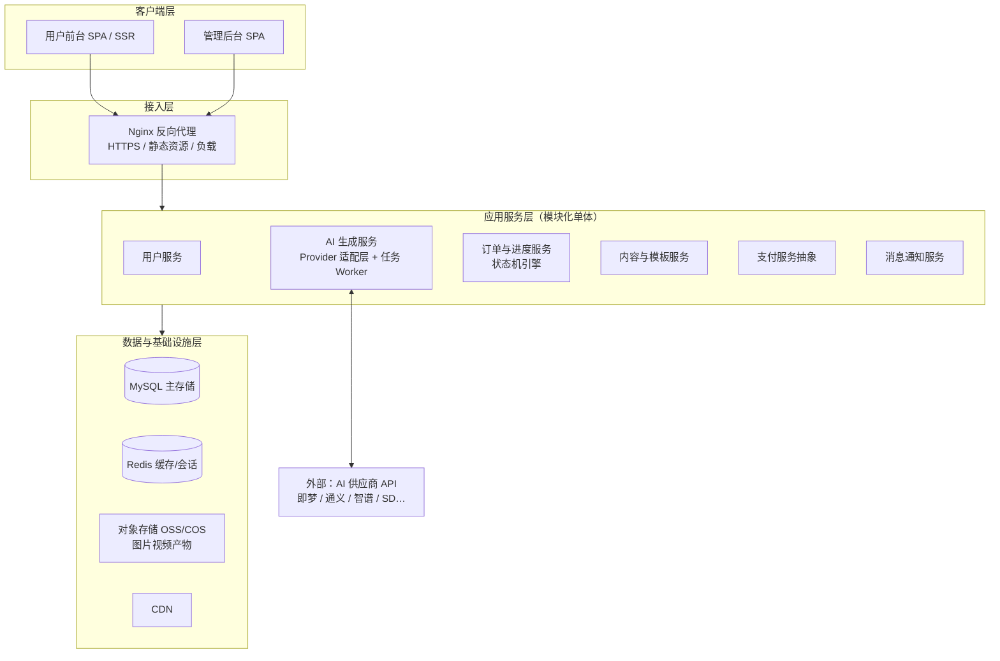
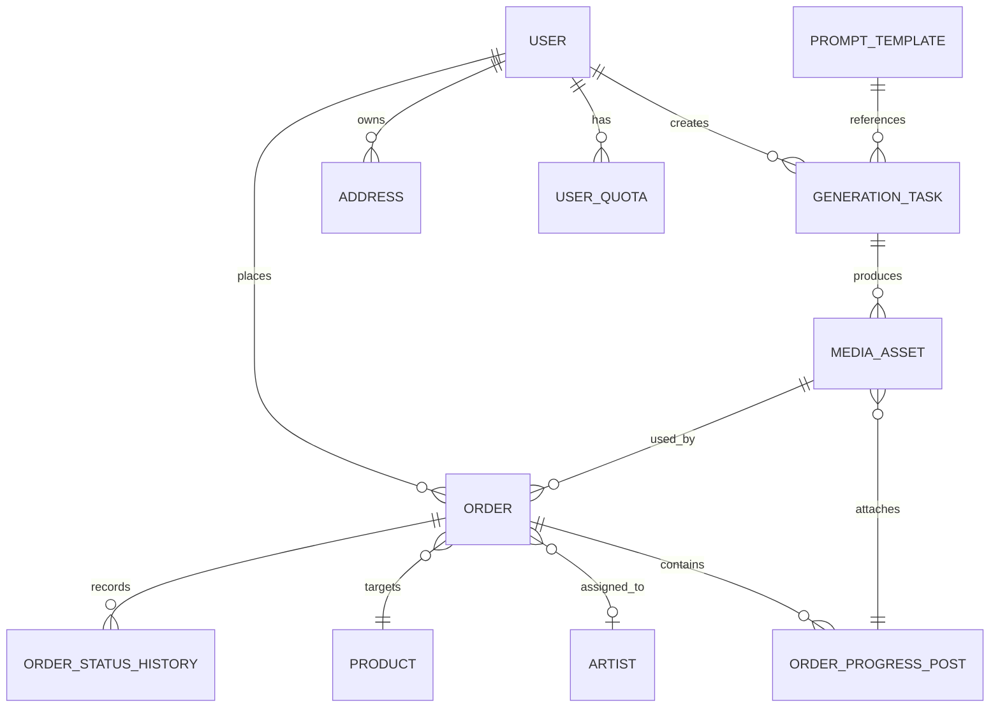

# 「镜绘」AI 形象定制创作平台 —— 网站制作文档

> 项目背景：全国大学生电子商务"三创赛"（创新、创意及创业挑战赛）非遗主题参赛项目
> 文档版本：v1.1（2026-11-04）
> 变更说明：项目定名「镜绘」；业务流程调整为"用户 AI 生成满意形象 → 交付画师手工创作"；**本期不实现画师端前后端**，画师协作与进度录入由平台运营方在管理后台代为完成，接口与数据结构预留画师维度。
> 文档性质：开发依据文档，后续所有设计、开发、测试工作以本文档为准

---

## 一、网站主题与定位

### 1.1 主题

**「镜绘」—— 以 AI 为镜，照见心中之形；以画师之手，绘成传世之作。**

用户通过自然语言提示词（或平台预设的国风 / 非遗风格模板）AI 生成自己满意的**形象画作**（人物画像、国风头像、场景插画等）；对生成结果满意后一键下单，平台将定稿形象交付**签约画师**进行传统手工创作（工笔画、油画、国画卷轴、扇面、瓷板画、刺绣画像等），用户可在平台全程追踪画师从起稿到装裱的创作进度，最终收到独一无二的实体作品。

### 1.2 定位

| 维度 | 定位描述 |
| --- | --- |
| 一句话定位 | AI 画心中所想，画师落笔成真——每个人的专属形象定制平台 |
| 产品形态 | Web 响应式网站（移动端优先），后续可扩展微信小程序 |
| 核心差异化 | ① AI 反复生成直到满意，"先试稿再下单"零风险；② AI 定稿 + 画师手绘的双层价值（创意效率 × 手作温度）；③ 创作全流程透明化追踪，亲眼见证画纸上的诞生过程 |
| 商业模式 | 定制作品销售差价 + 高级生成 / 视频生成付费 + 画师签约分成（三创赛答辩可阐述） |
| 与非遗的关系 | AI 只负责"形"的创意探索，"神"的落笔坚守画师手工创作本体——平台同时为传统画师带来数字化获客渠道 |

---

## 二、建设目的与目标用户

### 2.1 建设目的

1. **参赛核心交付物**：作为三创赛项目的线上平台载体，支撑"创新性、创意性、创业性"三维评审展示。
2. **消除定制决策风险**：传统画像定制"开盲盒"——付款前不知效果。AI 生成让用户先看到满意的样子再下单，转化率与满意度双升。
3. **建立消费信任**：通过创作进度可视化（起稿、勾线、上色、装裱各阶段实拍），解决定制类电商"下单后黑盒等待"的痛点，放大手绘价值感。
4. **为画师赋能**：传统画师普遍缺乏线上获客与订单管理能力，平台承担线上接单、进度同步、素材管理工作，画师专注创作即可（本期由运营方代录，二期开放画师端）。
5. **商业验证**：为赛后真实创业运营预留完整可扩展的技术底座。

### 2.2 目标用户画像

| 用户群体 | 特征 | 核心诉求 | 使用场景 |
| --- | --- | --- | --- |
| **C 端消费者（主）** | 18–35 岁，追求个性化、国潮审美，送礼或自用 | 先看到满意效果再下单；了解创作进度 | 生日 / 节日礼物、情侣画像、全家福、个人收藏、宠物画像 |
| **国风 / 非遗文化爱好者** | 关注传统文化，愿意为手作溢价付费 | 看到真实画师创作过程，情感连接 | 社交媒体种草后下单、追进度式"云监工" |
| **签约画师（平台供给侧）** | 国画 / 油画 / 非遗工艺画师，数字化能力弱 | 获客渠道、有人帮忙打理订单 | **本期不由画师直接操作系统**，与运营方线下对接（微信 / 电话），交付进度素材 |
| **评委 / 展示访客（赛事场景）** | 短时间浏览，关注创新点与完成度 | 快速理解业务闭环、看到可运行的 Demo | 赛前演示、答辩现场扫码体验 |
| **平台运营方（我们）** | 项目团队 | 画师档案管理、代录进度、内容与模板运营、数据统计 | 管理后台 |

---

## 三、核心功能模块

本期系统分为 **两个端**：用户前台（C 端）、管理后台（运营方）。**画师端不做前后端实现**，画师相关数据以"档案 + 关联"形式存在，进度由运营在后台代录；API 与数据库预留画师维度，二期可平滑开放画师工作台。

### 3.1 模块总览

```mermaid
flowchart LR
    subgraph 用户前台
        A1[首页与作品展示]
        A2[AI 形象创作工坊]
        A3[定稿下单]
        A4[订单与创作进度追踪]
        A5[个人中心]
    end
    subgraph 管理后台（运营方）
        C1[用户与订单管理]
        C2[提示词模板库管理]
        C3[AI 渠道与配额管理]
        C4[画师档案管理]
        C5[创作进度代录]
        C6[内容与数据看板]
    end
    画师[签约画师<br/>线下对接运营] -.微信/电话.-> 管理后台
```

### 3.2 模块一：AI 形象创作工坊（图片 / 视频生成）—— 核心创新模块

#### 3.2.1 功能描述

用户输入自定义提示词，或从平台**预设风格提示词模板库**（工笔人物风、水墨写意风、敦煌壁画风、剪纸风、青花瓷风、油画风、Q 版国潮风等，每类含多套参数化模板）一键套用并微调，生成**个人形象画作**：

- **图片（主能力）**：形象定稿图，作为下单交付画师的创作依据；
- **短视频（可选 / 付费能力）**：形象动效展示视频、作品宣传小视频。

典型玩法：用户上传自拍照（以图生图，二期）或直接描述（文生图，一期）→ 选择风格模板 → 反复生成直到满意 → 一键"定稿并下单"。

生成结果可保存到"我的形象"、重新生成、微调关键词迭代。

#### 3.2.2 生成方式

| 方式 | 说明 | 期次 |
| --- | --- | --- |
| 自由提示词 | 用户直接输入描述文本（支持中英文），可叠加风格标签 | 一期 |
| 预设模板 | 选择风格模板（如"工笔·仕女图"），模板内置正向/负向提示词与尺寸参数，用户可替换关键词（主体特征、服饰、意境等） | 一期 |
| 参数化微调 | 画幅比例（1:1 / 3:4 / 9:16）、生成数量、风格强度 | 一期 |
| 以图生图 | 上传本人 / 宠物照片 + 提示词生成形象，迭代优化 | 二期 |

#### 3.2.3 API 调用与可扩展接口设计（关键）

采用**适配器模式（Adapter Pattern）+ 渠道抽象层**，业务层不直接依赖任何具体 AI 供应商 SDK：

```
业务层 (GenerationService)
        │  仅依赖统一接口
        ▼
IAiProvider（统一供应商接口）
    ├── generateImage(prompt, params) -> TaskResult
    ├── generateVideo(prompt, params) -> TaskResult
    ├── queryTask(taskId) -> TaskStatus     # 异步任务轮询
    └── fetchResult(taskId) -> MediaAsset   # 拉取产物并落库
        │
        ├── JiemengProvider   （即梦 / 火山引擎）
        ├── TongyiProvider    （通义万相 / 阿里云百炼）
        ├── ZhipuProvider     （智谱 CogView / CogVideoX）
        ├── StabilityProvider （Stable Diffusion API，可选自部署）
        └── CustomProvider    （预留：后续任何新供应商 1 个类即可接入）
```

设计要点：

1. **统一任务模型**：无论供应商是同步返回还是异步任务，统一抽象为 `提交任务 → 轮询状态 → 获取结果` 三阶段；同步接口由适配器内部包装成"立即完成的任务"。
2. **配置驱动路由**：供应商、模型名、API Key、配额均存于数据库配置表 + 环境变量，可在管理后台切换渠道、按优先级降级，**不改代码**。
3. **失败降级**：主渠道失败自动切换备用渠道（可配置重试次数与顺序），全部失败则返还生成次数并提示用户。
4. **异步解耦**：生成请求经任务队列执行（MVP 用数据库任务表 + 后台 Worker 轮询，架构不变、实现降级，规模化后换 Redis Stream / MQ），前端轮询获取进度。
5. **计费与配额**：统一的"生成次数"账户体系（注册赠送、每日签到、付费购买），屏蔽不同供应商计费差异，为商业化预留。
6. **内容合规**：提示词入库先过敏感词过滤再提交供应商；以图生图的人脸照片遵循最小化存储原则（生成完成后源图可配置自动清理）；生成产物标记来源渠道与模型，便于审计与版权说明。

#### 3.2.4 关键页面 / 交互

- 创作工坊页：模板选择 → 提示词编辑（模板高亮可替换词）→ 参数选择 → 生成 → 结果九宫格 / 单图预览；
- 生成等待态：进度动画 + 国画 / 非遗知识小卡片轮播（缓解等待焦虑，兼传播文化）；
- 作品详情页：大图预览、下载、**"定稿并去定制"**（进入下单流）、重新生成、分享海报（含网站二维码）。

### 3.3 模块二：创作进度追踪 —— 核心信任模块

#### 3.3.1 功能描述

用户定稿下单后，订单进入画师创作流程。平台运营方与画师线下对接，将画师反馈的进度**在管理后台代录**，用户端以**阶段状态机 + 进度时间线 + 画师实拍素材**三重形式展示：

| 阶段（状态机） | 说明 | 运营动作（代录） | 用户可见 |
| --- | --- | --- | --- |
| 1. 已下单待确认 | 订单支付成功 | — | ✅ |
| 2. 定稿确认 | 平台整理 AI 定稿图与定制要求，用户最终确认 | 整理定稿说明 | ✅ 需用户确认按钮 |
| 3. 已交付画师 | 匹配并交付签约画师，画师接单 | 关联画师档案 | ✅ 展示画师署名（如"王画师 · 工笔十年"） |
| 4. 创作中（细分多子步骤） | 按画种拆子步骤，如工笔画：起稿 → 勾线 → 分染 → 罩染 → 题款钤印 | 每子步骤代录实拍图/短视频 + 文字说明 | ✅ 时间线逐条点亮 |
| 5. 质检装裱 | 成品质检、装裱照片 | 代录质检 / 装裱图 | ✅ |
| 6. 已发货 | 填写物流单号 | 填写单号 | ✅ 物流查询（二期可对接快递 API） |
| 7. 已完成 | 用户确认收货 | — | ✅ 可评价晒单 |

#### 3.3.2 设计要点

1. **状态机引擎**：状态流转规则集中配置（非法流转拒绝，如"质检装裱"不能跳回"已下单"），每次流转写入 `order_status_history` 流水表，天然形成进度时间线数据。
2. **运营代录界面**：后台做成"选订单 → 选阶段 → 传图/视频 → 一句话说明 → 发布"的极简表单，支持手机浏览器操作；录入人记入审计日志。
3. **画师维度预留**：订单关联画师档案（`artist_id`），进度动态记录 `posted_by`（本期恒为运营账号）；二期开放画师端时，画师账号直接复用同一套接口自行发布，**无需改数据结构**。
4. **用户通知**：状态变更触发站内信 + 邮件（可配置开关；微信服务号 / 短信二期接入）。
5. **"云监工"体验**：时间线支持实拍图灯箱浏览、视频播放；创作过程素材沉淀为作品详情页内容，形成"过程即内容"的传播素材（三创赛答辩亮点）。
6. **异常处理**：超期未更新（可配置天数）后台标红提醒运营跟进；"定稿确认"阶段用户可发起改稿（限次，超出引导重新生成）。

### 3.4 模块三：作品展示与商城

- **首页**：风格分类导航（工笔 / 水墨 / 油画 / 剪纸 …）、轮播主视觉、精选案例（AI 定稿 vs 画师成品对比图，强说服力）、画师推荐、AI 创作入口强引导。
- **画师专栏**：签约画师故事、擅长画种、代表作品、好评率（本期内容由运营维护，纯展示无交互）。
- **品类专栏**：各画种 / 非遗工艺介绍（历史渊源、工艺特点），图文 + 短视频，文化传播叙事（答辩加分项）。
- **定制载体库**：可定制的产品载体（国画卷轴、团扇扇面、瓷板画、油画布框、伴手礼盒…），含工艺说明、价格、工期、支持的图案尺寸。
- **下单流程**：选择定稿形象图 → 选择载体与画师偏好（可选）→ 确认定制细节（尺寸/装裱/题字）→ 填收货信息 → 支付（MVP 模拟支付 / 沙箱，预留支付渠道抽象接口，正式接入微信支付）。

### 3.5 模块四：用户系统与个人中心

- 注册登录：邮箱 + 密码（一期简化），表结构预留手机号 / 微信 openid 字段，二期平滑升级验证码与扫码登录；
- 个人中心：我的形象（AI 生成图库）、我的订单（含进度入口）、我的生成次数、收藏、地址管理、消息通知、晒单评价。

### 3.6 模块五：管理后台（运营方）

- 用户与订单管理（查询、状态干预、改稿处理、退款流程）；
- **画师档案管理**（新增/编辑画师：署名、画种、简介、代表作、分成比例、联系方式——联系方式仅后台可见）；
- **创作进度代录**（订单维度发布阶段动态、流转状态、上传实拍素材）；
- 提示词模板库管理（增删改查、分类、上下架、示例图绑定）；
- AI 渠道管理（供应商配置、Key 管理、配额与用量统计）；
- 数据看板（生成量、定稿率、下单转化率、热门模板、订单履约时效）。

---

## 四、整体技术架构与设计思路

### 4.1 架构总览



### 4.2 技术选型（推荐方案）

| 层 | 选型 | 理由 |
| --- | --- | --- |
| 前端框架 | **Vue 3 + TypeScript + Vite** | 团队上手快、生态成熟 |
| UI / 样式 | **Element Plus + Tailwind CSS** | Element Plus 快速搭后台与表单；Tailwind 负责前台响应式与定制视觉 |
| 状态/路由 | Pinia + Vue Router | 官方推荐组合 |
| 动效 | CSS 动画 + GSAP（按需） | 首页主视觉与纹样动效 |
| 后端框架 | **FastAPI (Python)** | 契合 AI 生态、异步支持好、自动生成 OpenAPI 文档；备选 Spring Boot（若团队 Java 更熟） |
| ORM | SQLAlchemy 2.0 + Alembic 迁移 | 类型安全 + 数据库版本管理 |
| 数据库 | **MySQL 8.0** | 订单 / 用户等关系数据主存储 |
| 缓存 | **Redis** | 会话、验证码、限流计数；MVP 任务队列先用 DB 表轮询 |
| 对象存储 | 腾讯云 COS / 阿里 OSS + CDN | AI 产物、创作实拍、商品图统一存储 |
| 部署 | Docker Compose（单机起步） | 一键起 Nginx + API + MySQL + Redis，便于演示与迁移 |

> **选型原则**：MVP 一切从简——"模块化单体 + 明确的服务边界"；接口按领域划分（`/api/ai/*`、`/api/order/*`…），为赛后规模化拆分留路。

### 4.3 后端设计思路

1. **分层**：Router（参数校验/鉴权）→ Service（业务逻辑）→ Repository（数据访问）→ Model（ORM）；AI 供应商适配层独立于业务 Service。
2. **统一响应体与错误码**：`{ code, message, data }`；错误码分段（1xxx 用户、2xxx 生成、3xxx 订单…），前后端共同维护错误码字典。
3. **鉴权**：JWT（Access + Refresh Token），Redis 维护刷新令牌；本期角色 `USER / ADMIN`，RBAC 控制；表结构预留 `ARTIST` 角色枚举，二期开放画师端时直接启用。
4. **AI 任务流转**：
   `POST /api/ai/generate`（校验配额→写 generation_task 记录→入队）→ Worker 取任务 → 调 Provider 适配器 → 轮询供应商 → 产物下载转存对象存储 → 更新任务状态 → 前端轮询 `GET /api/ai/tasks/{id}`。
5. **进度状态机**：状态流转规则配置化（JSON 存 DB），统一 `transition(order, event, operator)` 入口校验并写流水；进度动态发布接口本期仅 `ADMIN` 可调用，`operator_type` 字段区分，二期放开 `ARTIST` 调用即完成画师端接入。
6. **接口安全**：生成接口按用户限流（Redis 令牌桶）；上传文件类型与大小白名单；后台接口二次鉴权 + 操作审计日志。

### 4.4 数据库设计（核心表）



核心表字段（关键列，完整 DDL 在开发阶段随 Alembic 迁移脚本产出）：

| 表 | 关键字段 | 说明 |
| --- | --- | --- |
| `user` | id, email, phone(nullable 预留), password_hash, nickname, avatar, role(USER/ADMIN，预留 ARTIST), status | 用户与运营账号 |
| `user_quota` | user_id, remaining_count, total_purchased | 生成次数账户 |
| `prompt_template` | id, category(风格/画种), name, positive_prompt, negative_prompt, params_json, cover_media_id, is_published | 预设提示词模板 |
| `generation_task` | id, user_id, template_id(nullable), type(IMAGE/VIDEO), prompt, params_json, provider_code, provider_task_id, status(PENDING/RUNNING/SUCCESS/FAILED), error_msg, cost_count, created_at | AI 生成任务，全链路留痕 |
| `media_asset` | id, task_id(nullable), owner_type, owner_id, kind(GENERATED/PROGRESS/PRODUCT/AVATAR), url, thumbnail_url, width, height, duration, meta_json | 所有图片视频统一资产表 |
| `product` | id, name, category, base_price, craft_desc, lead_time_days, spec_json, status | 可定制载体（卷轴/扇面/瓷板等） |
| `artist` | id, pen_name(署名), real_name(仅后台), contact(仅后台), specialties(画种), intro, avatar, representative_media_ids, rating, status | **画师档案（本期无登录，纯数据档案）** |
| `order` | id, order_no, user_id, product_id, media_asset_id(定稿形象图), artist_id(nullable), spec_json, amount, status, shipping_info_json, confirmed_at | 订单主表 |
| `order_status_history` | id, order_id, from_status, to_status, operator_type(USER/ADMIN，预留 ARTIST), operator_id, note, created_at | 状态流水（时间线数据源） |
| `order_progress_post` | id, order_id, step_name, content, media_ids, posted_by(运营账号，预留画师), created_at | 创作子步骤动态（实拍+文字） |
| `message` | id, user_id, type, title, content, is_read, ref_order_id | 站内信/通知 |
| `ai_provider_config` | id, code, name, base_url, api_key_encrypted, models_json, priority, enabled | AI 渠道配置（后台可切换） |
| `admin_audit_log` | id, admin_id, action, target, detail_json, created_at | 后台操作审计（含代录留痕） |

### 4.5 API 设计概要（RESTful）

| 模块 | 代表性接口 | 备注 |
| --- | --- | --- |
| 认证 | `POST /api/auth/register` `POST /api/auth/login` `POST /api/auth/refresh` | |
| AI 生成 | `GET /api/ai/templates?category=` `POST /api/ai/generate` `GET /api/ai/tasks/{id}` `GET /api/ai/assets/{id}` | |
| 商品/画师展示 | `GET /api/products` `GET /api/artists` `GET /api/artists/{id}` | 画师仅公开署名与作品，不含联系方式 |
| 订单 | `POST /api/orders` `GET /api/orders?status=` `GET /api/orders/{id}` `POST /api/orders/{id}/confirm-design` | |
| 进度（用户） | `GET /api/orders/{id}/timeline` | |
| 进度（后台代录） | `POST /api/admin/orders/{id}/progress`（发布动态）`POST /api/admin/orders/{id}/status`（状态流转） | **二期开放画师端时新增同构接口 `POST /api/artist/orders/{id}/progress`，数据模型不变** |
| 画师档案（后台） | `GET/POST/PUT /api/admin/artists` | |
| 支付 | `POST /api/pay/orders/{id}` | 渠道抽象：`IPayChannel` → 微信支付 / 沙箱 |

---

## 五、前端视觉风格与非遗元素融入

### 5.1 设计原则

> **"镜"之清透，"绘"之雅致**：界面如宣纸留白，AI 形象与画师作品是绝对主角——避免元素堆砌导致的"旅游纪念品感"。

1. **留白克制**：大面积留白 + 宋体标题 + 细线条，呼应"宣纸 / 卷轴"的东方美学；
2. **一个主视觉焦点**：每屏只保留一个主视觉（形象大图 / 动效纹样），信息层级清晰；
3. **"AI → 手绘"的叙事动效**：首页核心视觉用"AI 定稿渐变晕染为手绘成品"的过渡动效，一句话讲清业务模式；
4. **动效服务内容**：纹样微动效（祥云缓移、水墨晕染转场）克制使用，尊重性能与无障碍（`prefers-reduced-motion` 适配）。

### 5.2 视觉规范（设计 Token）

| Token | 取值 | 用途 |
| --- | --- | --- |
| 主色 朱砂红 | `#B03A2E`（hover `#C74B3D`） | CTA 按钮、价格、进度高亮、钤印元素 |
| 辅色 黛蓝 | `#2C3E5D` | 导航、标题文字 |
| 中性 宣纸米白 | `#F7F3EA`（页面底） | 全局背景 |
| 点缀 鎏金 | `#C9A063` | 分割线、图标描边、徽标 |
| 墨黑 | `#2B2B2B` | 正文文字 |
| 标题字体 | 思源宋体 / 霞鹜文楷（开源授权） | 中文标题 |
| 正文字体 | 系统默认无衬线 + 思源黑体 | 正文、按钮 |
| 圆角 | 4px（整体偏硬朗，呼应器物感） | 卡片、按钮 |
| 阴影 | 极浅投影 + 1px 鎏金描边替代重阴影 | 卡片 |

### 5.3 非遗 / 国风元素融入方式

| 位置 | 元素 | 实现方式 |
| --- | --- | --- |
| 首页主视觉 | "镜绘"书法字 Logo + AI 定稿晕染为手绘成品的过渡动效 | 视频 / Lottie / CSS mask 过渡 |
| 导航栏 | 回纹（雷纹）底边线 | SVG pattern，滚动时鎏金流光 |
| 形象卡片 | 剪纸窗花镂空边角 + 朱砂钤印角标（"定稿"印章样式） | SVG clip-path / mask |
| 进度时间线 | 卷轴展开节点 | 每完成一阶段节点"点亮"（朱砂红 + 鎏金光晕），寓意"一笔一画，渐成佳作" |
| 章节分隔 | 祥云纹分隔条 | 内联 SVG，`currentColor` 随主题换色 |
| 加载等待 | 水墨晕染 spinner + 毛笔笔触进度条 | CSS/SVG 动画，配合非遗知识卡片 |
| 空状态 | 画轴 + "一纸空白，待你落笔" | 插画 + 文案结合 |
| 图标体系 | 文房器具线性图标（毛笔、砚台、印章、画轴） | 统一 24px 线性风格 |
| 页脚 | 卷轴收边 + 画师传承声明 | 强化品牌叙事 |

### 5.4 响应式适配（移动优先）

1. **断点**（Tailwind 默认）：`sm 640 / md 768 / lg 1024 / xl 1280`；设计基准先做 375px 移动稿，再向上增强。
2. **关键适配点**：
   - 首页主视觉移动端改为竖版构图 + 纹样裁切焦点；
   - 创作工坊：桌面为"左编辑右预览"双栏，移动端上下堆叠、底部悬浮"生成"按钮；
   - 进度时间线：移动端纵向单列，节点靠左、内容卡片靠右；
   - 导航：`lg` 以下折叠为抽屉菜单（抽屉背景配窗花纹理）；
   - 图片统一 `srcset` + 懒加载；视频移动端默认标清。
3. **触控与性能**：按钮点击热区 ≥ 44px；首屏 JS 按路由分包；大图走 CDN 缩略图 + 灯箱加载原图。
4. **验收标准**：Chrome DevTools 主流机型（iPhone SE/12/14 Pro Max、iPad、1280/1440/1920 桌面）无横向滚动、无元素遮挡、可读性达标。

---

## 六、分阶段构建步骤与里程碑

> 总周期建议 **10 周**（与三创赛备赛节奏对齐），每阶段末有可演示产物。

### 阶段〇：立项与设计定稿（第 1 周）

- [ ] 确定「镜绘」品牌 Logo / 视觉锤 / 一句话定位；
- [ ] 本文档评审定稿，输出需求清单与接口契约初稿；
- [ ] UI：完成设计 Token、首页与创作工坊高保真稿（Figma / 即时设计）；
- [ ] 注册域名、购买云服务器与对象存储，申请 AI 供应商 API Key；
- [ ] 线下签约首批画师（≥ 3 位，覆盖 2–3 个画种），明确交付与分成约定。

**里程碑 M0**：设计稿定稿 + 开发环境就绪（Git 仓库、CI、Docker Compose 骨架跑通）。

### 阶段一：基础框架与用户系统（第 2–3 周）

- [ ] 前端：项目脚手架、路由布局、设计 Token 落地、响应式栅格基座；
- [ ] 后端：项目分层骨架、统一响应/错误码、JWT 鉴权、MySQL 建表与迁移；
- [ ] 功能：注册 / 登录 / 个人中心骨架、管理后台框架 + RBAC（USER/ADMIN）。

**里程碑 M1**：用户可注册登录，后台可管理用户，前后端联调规范跑通。

### 阶段二：AI 形象创作工坊（第 4–5 周）★ 核心攻坚

- [ ] Provider 适配层：完成 2 家供应商（建议：即梦 + 通义万相）图片生成适配；
- [ ] 任务系统：任务表 + Worker 轮询 + 状态查询；
- [ ] 模板库：首批 ≥ 6 个风格品类、≥ 20 套预设提示词模板（含示例图）；
- [ ] 前台：模板选择、提示词编辑、参数、结果预览与"我的形象"；
- [ ] 配额与敏感词过滤；生成产物转存对象存储 + CDN。

**里程碑 M2**：完整跑通"选模板 → 输入提示词 → 生成形象 → 反复迭代 → 定稿"Demo（答辩演示第一条主线）。

### 阶段三：下单 / 进度追踪 / 后台代录（第 6–7 周）★ 核心攻坚

- [ ] 载体库、画师专栏、品类科普内容填充（≥ 12 个载体、≥ 3 位画师档案、≥ 5 篇科普）；
- [ ] 下单流程（含模拟支付，预留微信支付抽象接口）；
- [ ] 状态机引擎 + 订单流水 + 站内信通知；
- [ ] 管理后台：画师档案管理 + 进度代录（选订单 → 传图 → 发布）；
- [ ] 用户端：订单列表、进度时间线（卷轴节点点亮动效）、实拍素材灯箱、定稿确认与改稿。

**里程碑 M3**：跑通"定稿 → 下单 → 运营代录进度 → 用户看到进度 → 收货完成"全链路（答辩演示第二条主线）。

### 阶段四：打磨与扩展（第 8 周）

- [ ] 视觉打磨：首页"AI→手绘"叙事动效、纹样动效、加载态、空状态、分享海报；
- [ ] 视频生成能力接入（第二家供应商视频模型，作为付费点演示）；
- [ ] 数据看板（生成量、定稿率、转化率、履约时效）；
- [ ] 内容合规与安全加固（限流、审计、上传白名单）。

**里程碑 M4**：视频生成 + 看板上线，功能冻结。

### 阶段五：测试、部署与参赛材料（第 9–10 周）

- [ ] 全端响应式走查、核心链路 E2E 测试、压测（生成接口并发）；
- [ ] 正式域名 + HTTPS 上线，导入演示种子数据；
- [ ] 参赛材料：演示脚本（3 分钟双主线）、答辩 PPT、项目计划书技术章节引用本文档；
- [ ] 备用预案：现场断网时本地录屏 + 离线 Demo 数据。

**里程碑 M5（终）**：平台公网可访问，参赛演示就绪。

### 里程碑总览

| 里程碑 | 时间 | 交付物 | 演示价值 |
| --- | --- | --- | --- |
| M0 | 第 1 周末 | 设计稿 + 环境 + 画师签约 | 项目专业度 |
| M1 | 第 3 周末 | 用户系统 | 基础能力 |
| M2 | 第 5 周末 | AI 形象创作工坊 | ★ 创新点 |
| M3 | 第 7 周末 | 定稿下单 + 进度全链路 | ★ 闭环 |
| M4 | 第 8 周末 | 视频 + 看板 | 商业化潜力 |
| M5 | 第 10 周末 | 上线 + 参赛材料 | 最终交付 |

### 二期规划（赛后，仅列方向不在本期范围）

- 画师工作台（复用预留接口与数据模型，画师自行接单、发布进度）；
- 以图生图（上传照片生成形象）、微信扫码登录、小程序端；
- 物流查询 API 对接、微信模板消息；
- 画师结算与分成系统。

---

## 七、风险与应对（附录）

| 风险 | 应对 |
| --- | --- |
| AI 供应商 API 不稳定 / 停服 | 适配层多渠道热切换 + 失败降级（见 3.2.3） |
| 生成内容涉敏 / 人像合规 | 提示词前置过滤 + 供应商侧审核 + 人工抽检；以图生图源图最小化存储 |
| 生成成本超预算 | 配额体系 + 后台用量监控 + 优先选低价模型 |
| 画师交付延期 | 工期预估进订单页明示；后台超期标红提醒；运营主动跟进并向用户同步 |
| 画师线下协作效率低 | 后台代录表单极简（手机可操作）；画师素材收取走微信群 SOP |
| 赛程压缩 | M2 / M3 为不可让的底线；视频、看板、物流查询均为可砍项 |
| 团队技术栈差异 | 本文档选型可整体替换（Vue→React、FastAPI→Spring Boot），架构与库表设计不变 |

---

*本文档为 v1.1 基线，所有变更需在团队评审后更新版本号并记录变更说明。*
